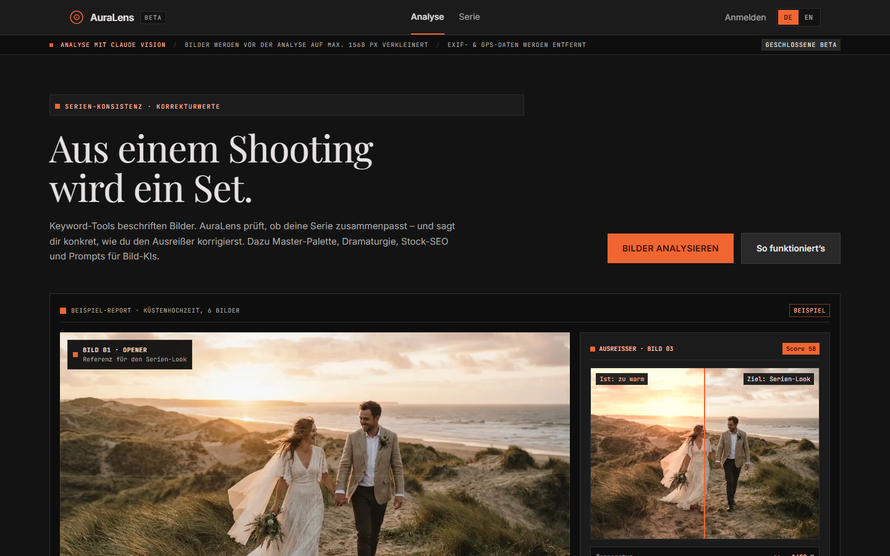

# AuraLens

**Live:** [auralens-five.vercel.app](https://auralens-five.vercel.app) · **Beispiel-Report ohne Login:** <!-- DEMO-LINK --> *folgt* · **Public API:** [`docs/API-v1.md`](docs/API-v1.md)




> **English summary:** AuraLens is a full-stack AI web app for photographers. Upload one photo or a series of up to 10, and it combines deterministic pixel measurements (CIE Lab, CIEDE2000, colour temperature, exposure, sharpness, noise) with Claude Vision to produce a structured report: visual style, colour palette, series consistency with concrete correction values for outliers, storytelling, stock SEO, and prompts for four image models. Built with Next.js 16, TypeScript, Supabase (Postgres + RLS), and the Anthropic API, with a public REST API, credits, async jobs, 269 tests, and CI.

AuraLens ist ein KI-gestützter Stil- und Konsistenz-Analyst für Fotograf:innen. Man lädt ein Einzelbild oder eine Serie (2–10 Bilder) hoch und bekommt einen strukturierten Report:

- **Gemessen statt geschätzt:** Farbpalette (Lab-k-means), Farbtemperatur und Duv, Belichtung, Clipping, Kontrast, Schärfe und Rauschen werden direkt aus den Pixeln berechnet. Claude bekommt diese Werte als verbindliche Fakten und interpretiert sie nur.
- **Serien-Konsistenz:** Die App findet heraus, welches Bild aus der Reihe fällt, und nennt konkrete Korrekturwerte, z. B. „+300 K, −0,3 EV“. Die Abweichung wird gegen den Median der Serie gemessen.
- **Storytelling und Markt-Fit:** Stil, Emotionen, die Dramaturgie der Serie und die Rolle jedes Bildes.
- **Exporte:**
  - Stock-SEO (Titel + 25 Keywords), CSV für Adobe Stock, Shutterstock und Freepik
  - XMP/IPTC-Metadaten direkt in das Original-JPEG geschrieben (läuft im Browser), XMP-Sidecars für RAW
  - Tailwind-Design-Tokens aus der Palette, ZIP-Paket mit dem kompletten Report
- **Prompts:** je ein Prompt für Midjourney, FLUX/SDXL, Adobe Firefly und ChatGPT Images. Das Seitenverhältnis wird aus den echten Pixelmaßen berechnet.
- **Teilen:** Schreibgeschützte Links (`/r/<token>`), die man jederzeit widerrufen kann.
- Zweisprachig (DE/EN), geschlossene Beta mit Einladungscodes und Credits.

## Technische Highlights

| Thema | Umsetzung |
|---|---|
| **Strukturierte KI-Ausgabe** | Zod-Schemas als Single Source of Truth; `messages.parse()` liefert typsichere Reports ohne manuelles JSON-Parsing. |
| **Grammatik-Limit umgangen** | Das Serien-Schema war zu groß für Structured Outputs (`compiled grammar is too large`). Deshalb laufen drei parallele, gestreamte Teilanalysen (Konsistenz, Markt, Prompts), die serverseitig zusammengeführt und auf Plausibilität geprüft werden. Schlägt ein Teil fehl, werden die anderen abgebrochen. |
| **Deterministische Bildmessung** | `lib/measure/`: CIEDE2000, CCT über den Planckschen Ort, Laplace-Schärfe, Immerkær-Rauschschätzung. Alle Funktionen sind mit Unit-Tests abgesichert. |
| **Asynchrone Jobs** | `POST` antwortet sofort mit `202`, danach Polling mit echtem Teilschritt-Fortschritt. Läuft nach einem Neuladen weiter, Idempotency-Keys verhindern doppelte Abbuchung, ein `pg_cron`-Sweep erstattet hängende Jobs. |
| **Public API v1** | API-Keys (nur als Hash gespeichert), Credits als Ledger in Postgres, Fehler nach RFC 9457, Rate-Limits, CORS, Postman-Collection. |
| **Sicherheit & Kosten** | Row Level Security auf allen Tabellen. Der Service-Role-Key wird nur von der API genutzt, und dort filtert jede Abfrage nach `user_id`. Dazu ein globales Tagesbudget, Sperre für Wegwerf-Mail-Adressen, Audit-Log. Bilder werden direkt nach dem Auslesen gelöscht, EXIF/GPS wird vorher entfernt. |
| **Qualität** | 269 Tests (Vitest + React Testing Library), ESLint, `tsc --noEmit`. GitHub Actions baut bei jedem Push und Pull Request (Lint, Typecheck, Tests, Build, Docker-Build). |

## Tech Stack

- **Frontend & Backend:** Next.js 16 (App Router, `proxy.ts`, `after()`), React 19, TypeScript, Tailwind CSS v4
- **KI:** Anthropic Claude API (Vision, Structured Outputs). Das Modell ist per `ANTHROPIC_MODEL` konfigurierbar.
- **Auth, DB & Storage:** Supabase (Postgres + RLS, Auth mit E-Mail und Google, privater Storage, `pg_cron`)
- **Bildverarbeitung:** `sharp` auf dem Server, Canvas im Browser
- **Hosting:** Vercel (Produktion, täglicher Keepalive-Cron) + Supabase (EU, Frankfurt). Lokal alternativ Docker (Multi-Stage, `standalone`).

## Architektur (Auszug)

```
app/page.tsx                    Landing Page + Einzelbild-Analyse
app/serie/page.tsx              Serien-Analyse: Mehrfach-Upload, Live-Fortschritt, Sortieren/Gruppieren
app/r/[token]/page.tsx          Öffentlicher, schreibgeschützter Report (Share-Link)
app/dashboard/                  Historie, Detailansicht, API-Keys & Credits, Konto & Daten (Export/Löschung)
app/api/v1/                     Public API v1 (Analysen, Uploads, API-Keys, Usage, Einladungscodes)
app/api/cron/keepalive          Täglicher Ping, damit das kostenlose Supabase-Projekt nicht pausiert
lib/services/                   Einzelbild- und Serienanalyse mit Claude Vision
lib/measure/                    Deterministische Pixelmessung + Serienvergleich mit Korrekturwerten
lib/analysis-schema.ts          Zod-Schema Einzelbild-Report
lib/series-analysis-schema.ts   Zod-Schemas der drei Serien-Teilanalysen
lib/prompt-engine.ts            Plattformspezifische Prompt-Regeln + Seitenverhältnis
lib/embedded-metadata.ts        XMP/IPTC in JPEGs schreiben, XMP-Sidecars
lib/report-package.ts, zip.ts   ZIP-Export (Markdown, JSON, CSV, XMP)
lib/api/                        Auth (Key/Sitzung), RFC-9457-Fehler, Repository, Uploads, Job-Queue
lib/i18n/                       DE/EN-Wörterbücher, identische Schlüssel per Typ und Test erzwungen
supabase/migrations/            Schema, RLS, SQL-Funktionen (Credits, Jobs, Budget, Shares)
```

Details zu Routen und Report-Aufbau: [`docs/API.md`](docs/API.md), Public API: [`docs/API-v1.md`](docs/API-v1.md).

## Lokal starten

### 1. Supabase (lokal, kein Account nötig)

```bash
npx supabase start
```

Der Befehl gibt die `Project URL`, den `Publishable`-Key und den `Secret`-Key aus. Trag sie in `.env.local` ein:

| Wert aus der Ausgabe | Variable in `.env.local` |
|---|---|
| `Project URL` | `NEXT_PUBLIC_SUPABASE_URL` |
| `Publishable`-Key | `NEXT_PUBLIC_SUPABASE_ANON_KEY` |
| `Secret`-Key | `SUPABASE_SERVICE_ROLE_KEY` |

Studio (Datenbank-Oberfläche): http://127.0.0.1:54323

### 2. App

```bash
cp .env.local.example .env.local   # ANTHROPIC_API_KEY + Supabase-Werte eintragen
npm install
npm run dev                        # http://localhost:3001
npm run invite-codes               # Einladungscodes für die Registrierung erzeugen
```

Analysen brauchen ein Konto und Credits (Beta: 20 pro Konto). Ohne `ANTHROPIC_API_KEY` startet die App trotzdem. Analysen schlagen dann mit einer kontrollierten Fehlermeldung fehl, und die Credits werden erstattet.

Der Port ist fest auf **3001** gesetzt. Ist er belegt, bricht `npm run dev` ab, statt still auf einen anderen Port auszuweichen.

### 3. Mit Docker

```bash
docker compose up -d --build       # http://localhost:3100
```

`NEXT_PUBLIC_SUPABASE_URL` wird beim Build in das Browser-Bundle eingebacken. Der Server im Container erreicht ein lokales Supabase deshalb über `SUPABASE_URL=http://host.docker.internal:54321` (in `docker-compose.yml` schon gesetzt).

### Per API

API-Key unter *Meine Analysen → API & Credits* erstellen, dann:

```bash
curl -H "Authorization: Bearer al_live_…" -F images=@bild1.jpg -F images=@bild2.jpg \
  http://localhost:3001/api/v1/analyses          # → 202 + id
curl -H "Authorization: Bearer al_live_…" http://localhost:3001/api/v1/analyses/<id>
```

1–10 Bilder pro Analyse, 1 Credit pro Bild, Dauer ca. 30–60 s.

## Tests

```bash
npm test             # Vitest, einmalig
npm run lint
npm run typecheck
```

Automatisch getestet sind:

- Zod-Schemas, Pixelmessung und Farbmathematik
- Serienvergleich, Metadaten-Export und ZIP
- API-Routen mit gemocktem Anthropic- und Supabase-Client (Credits, Erstattung, Rate-Limits, Fehlerformat)
- UI-Komponenten und ein Integrationstest der Serien-Seite gegen ein simuliertes Backend

Auth-Flow und Storage wurden manuell gegen einen echten Supabase-Stack geprüft.

## Bekannte Grenzen

- Rate-Limits liegen im Arbeitsspeicher und gelten damit pro Instanz. Bei mehreren Instanzen braucht es einen geteilten Store, z. B. Redis.
- Hintergrund-Jobs laufen über `after()` innerhalb des Vercel-Funktionslimits (300 s). Eine echte Queue (Inngest/Trigger.dev) ist bewusst noch nicht eingebaut.
- Geschlossene Beta: Registrierung nur mit Einladungscode.

## Autor

Ingo Schwarzhaupt · [GitHub](https://github.com/ingo-code)
